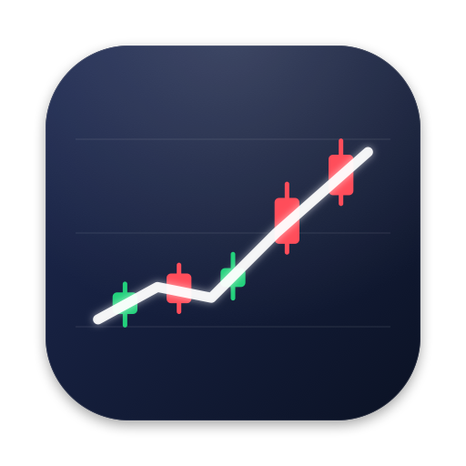
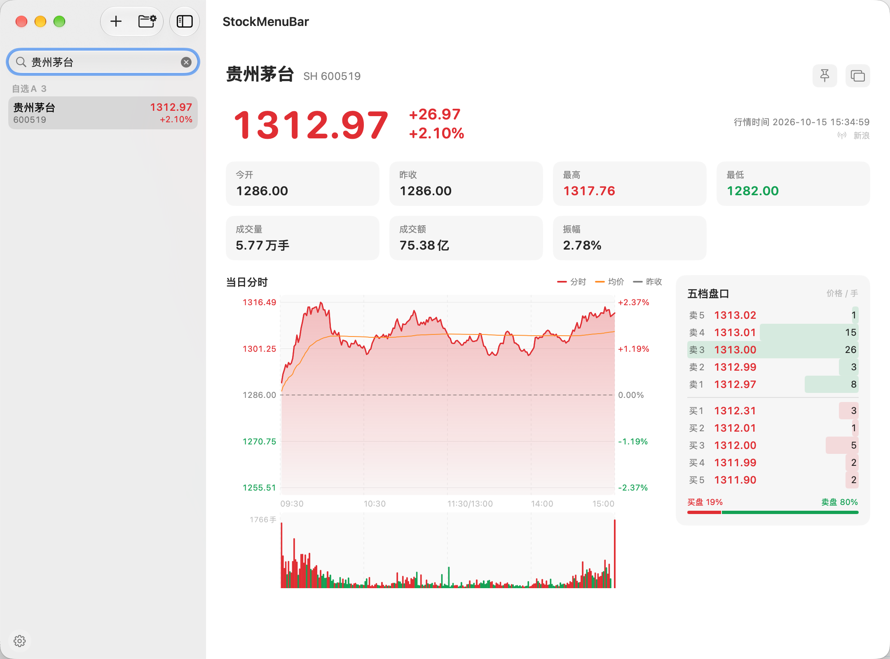
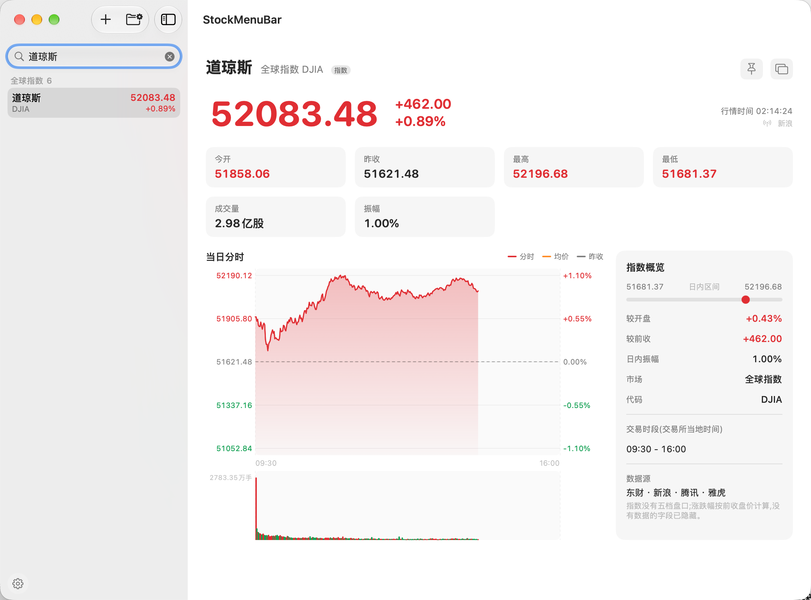
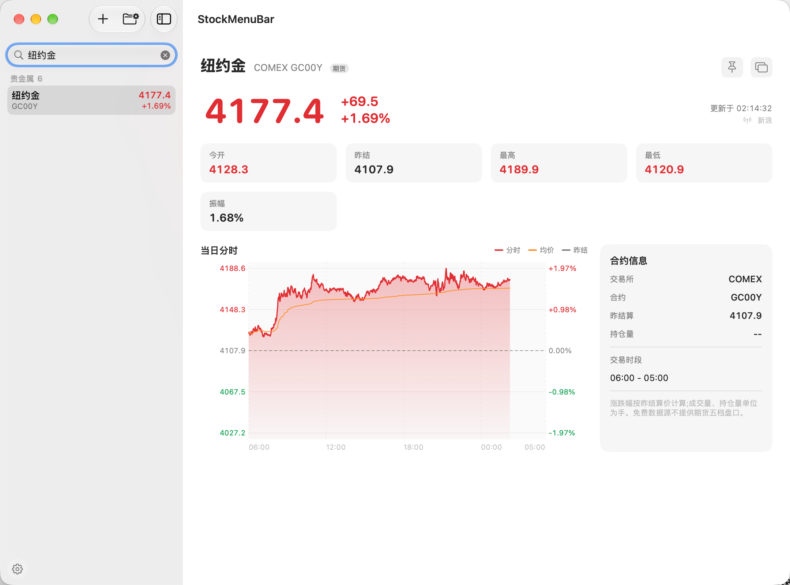
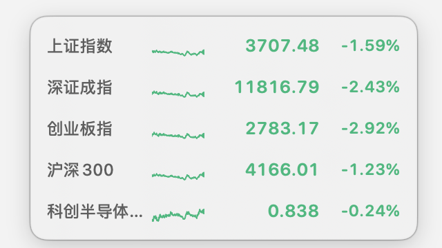

<div align="center">



# StockMenuBar

**原生 macOS 菜单栏行情监控:A 股、期货、贵金属、全球指数**

菜单栏常驻 · Popover 速览 · 主面板深度查看 · 悬浮迷你窗 · 多数据源高可用自动切换

[](https://github.com/ixxxxoooo/StockMenuBar/actions/workflows/ci.yml)


[](LICENSE)

[English](README.en.md) · 简体中文

</div>



## 功能特性

- **四种形态**:菜单栏着色标题(可固定多只并轮播)、Popover 速览、主面板(分时图 + 成交量 + 五档)、可拖动的悬浮迷你窗(胶囊 / 列表 / 卡片)。
- **覆盖品种**
  - A 股、ETF、指数(沪 / 深 / 北交所,自动识别创业板、科创板)
  - 期货:沪铜、伦铜、COMEX 铜、焦煤、焦炭、沪金、沪银,以及任意具体合约
  - 贵金属:纽约金、伦敦金、纽约银、伦敦银
  - 全球指数:道琼斯、纳斯达克、标普 500、日经 225、韩国 KOSPI / KOSDAQ,可搜索添加德国 DAX、英国富时 100、法国 CAC40 等
- **高可用行情**:腾讯、新浪、东方财富、雅虎财经多源路由,按延迟与成功率排序,熔断 + 对冲请求 + 数据校验;分时数据不完整时自动换源、失败自动退避重试。
- **自选管理**:分组、拖拽自定义排序、拼音首字母 / 中文 / 代码搜索、右键置顶 / 固定到菜单栏 / 加入悬浮窗。
- **智能刷新**:交易时段 3 / 5 / 10 秒,午休 1 分钟,休市不轮询;睡眠、锁屏、屏保自动暂停;期货与外盘按各自开市窗口轮询。
- **体验细节**:红涨绿跌(可反转)、价格闪色、深浅色、Dock 图标随主面板显示、⌥⌘F / ⌥⌘L / ⌥⌘H 全局快捷键(悬浮窗 / 穿透 / 老板键)、⌘, 打开偏好设置。
- **零依赖**:Swift 6 严格并发 + SwiftUI + AppKit + Swift Charts + SwiftData。

| 全球指数 | 贵金属 | 悬浮迷你窗 |
| --- | --- | --- |
|  |  |  |

## 数据源

| 品种 | 行情 | 分时 |
| --- | --- | --- |
| A 股 / ETF / A 股指数 | 腾讯 → 新浪 → 东财 | 腾讯 → 东财 → 新浪(1 分钟线合成) |
| 国内期货 | 东财 → 新浪 | 东财 → 新浪 |
| 外盘期货 / 贵金属 | 东财 → 新浪 → 雅虎 | 东财 → 新浪(外盘分时) → 雅虎 |
| 美股指数 | 东财 → 新浪 / 腾讯 → 雅虎 | 东财 / 腾讯 → 雅虎 |
| 日经 / 韩国指数 | 东财 / 新浪 → 雅虎 | 东财 → 雅虎 |

实际顺序由路由根据实时健康度动态决定,上表只是能力矩阵。字段映射与实测结论见 [docs/DATA_SOURCES.md](docs/DATA_SOURCES.md)。

## 安装与运行

### 环境要求

- macOS 14 (Sonoma) 及以上
- Xcode 16 及以上(Swift 6)
- [XcodeGen](https://github.com/yonaskolb/XcodeGen):`brew install xcodegen`

### 构建

```bash
git clone https://github.com/ixxxxoooo/StockMenuBar.git
cd StockMenuBar
xcodegen generate                       # 生成 StockMenuBar.xcodeproj
xcodebuild -scheme StockMenuBar -configuration Release -derivedDataPath build build
open build/Build/Products/Release/StockMenuBar.app
```

也可以 `open StockMenuBar.xcodeproj` 后在 Xcode 里直接运行。应用使用 ad-hoc 签名并启用沙盒(仅 `network.client`),首次打开若被 Gatekeeper 拦截,请在「系统设置 → 隐私与安全性」中允许。

### 测试

```bash
xcodebuild test -scheme StockMenuBar -destination 'platform=macOS' -derivedDataPath build
# 含真实网络的用例(默认跳过)
TEST_RUNNER_LIVE_TESTS=1 xcodebuild test -scheme StockMenuBar -destination 'platform=macOS' -derivedDataPath build
```

### 调试启动参数

`--show-main` `--show-settings` `--show-popover` `--show-floating` `--pin=sh000001,sz399001` `--fail-source=tencent,sina`(让指定数据源恒定失败,用于验证故障转移)。

## 项目结构

```
StockMenuBar/
├─ App/          应用生命周期、菜单栏、主窗口与悬浮窗控制器、全局快捷键
├─ Core/         QuoteStore(单一行情数据源)、调度器、交易时钟、自选与偏好
├─ Data/
│  ├─ Models/    证券标识、行情与分时模型、期货/指数目录
│  └─ Providers/ 腾讯 / 新浪 / 东财 / 雅虎 + ProviderRouter(熔断、对冲、覆盖度排序)
├─ Features/     主面板、Popover、悬浮窗、搜索等界面
├─ Shared/       主题、格式化、GBK 解码、东八区时间、应用信息
└─ Resources/    资源与应用图标
StockMenuBarTests/  Swift Testing 用例与真实接口样本(Fixtures)
Tools/              图标生成脚本
docs/               架构与数据源文档
```

架构概览见 [docs/ARCHITECTURE.md](docs/ARCHITECTURE.md);设计与开发过程记录见 [开发进度.md](开发进度.md)。

## 常见问题

- **数据延迟或缺失?** 行情来自公开免费接口,可能有数秒到数分钟延迟;某个数据源被限流时会自动切到其余数据源,可在「偏好设置 → 行情数据源」查看各源状态。
- **韩国指数没有成交量?** 这些指数的免费数据源不提供成交量,界面会隐藏没有数据的字段。
- **升级后自选没了?** 1.1.0 起 Bundle ID 改为 `com.ixxxxoooo.StockMenuBar`,数据存放在新的沙盒容器中。

## 参与贡献

欢迎 Issue 与 PR,请先阅读 [CONTRIBUTING.md](CONTRIBUTING.md)。

## 免责声明

本项目的行情数据全部来自第三方公开接口,仅供个人学习与参考,不保证准确、完整与及时,**不构成任何投资建议**。使用者需自行承担使用风险;请遵守各数据提供方的服务条款,勿用于商业用途或高频抓取。

## 许可证

[MIT](LICENSE) © 2026 [ixxxxoooo](https://github.com/ixxxxoooo)
